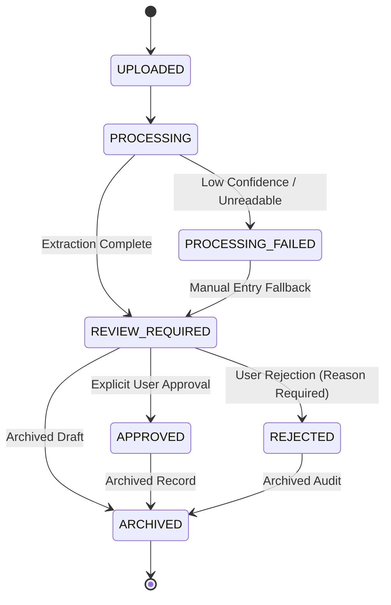

# MIZAN (ميزان) — PHASE 6.5 COMPLETION REPORT
## Expense Scanning, Vision OCR & Bookkeeping Ledger Architecture

---

### Executive Summary

Phase 6.5 delivers an end-to-end, production-grade expense scanning and bookkeeping workflow for **Mizan (ميزان)**. The implementation provides:
1. **Multi-Source Receipt Ingestion**: Native camera capture and gallery upload with MIME magic-byte verification, SHA-256 integrity hashing, and authenticated isolated storage.
2. **Structured Vision OCR Extraction**: Vision-based text extraction capturing merchant name, 15-digit UAE TRN, receipt number, date, currency, subtotal, VAT rate, VAT amount, total amount, line items, and confidence ratings.
3. **Strict Non-Fabrication Guarantee**: OCR output is strictly stamped as an **Unverified Draft** (`REVIEW_REQUIRED`). No simulated or hallucinated numbers are ever promoted to ledger postings without explicit human approval.
4. **Complete Expense Lifecycle State Machine**: Full lifecycle management covering `UPLOADED` → `PROCESSING` → `REVIEW_REQUIRED` → `APPROVED`, alongside `PROCESSING_FAILED`, `REJECTED`, and `ARCHIVED`.
5. **Standardized 17 UAE Expense Categories**: Bilingual (English & Arabic) tax categories compliant with Federal Decree-Law No. (8) on VAT and Federal Decree-Law No. (47) on Corporate Tax.
6. **Statutory Financial Arithmetic & CBUAE FX**: Deterministic Decimal calculations using banker's rounding (`ROUND_HALF_EVEN`), reconciling `Subtotal + VAT = Total`, with statutory CBUAE Article 69 exchange rate conversion evidence for foreign currency receipts.
7. **Multi-Factor Duplicate Receipt Detection**: Signal detection combining SHA-256 file hashes, vendor names, receipt numbers, dates, and amounts to prevent duplicate VAT claims without destructive auto-deletion.
8. **Real Bookkeeping Ledger & Aggregations**: Monthly expense summaries, category distributions, net margin calculations, and unified chronological transaction ledgers in the mobile app.
9. **Zero-Trust Multi-Tenant Isolation**: Enforced organisation-level and active-business isolation on every read, write, scan, approval, and attachment stream.
10. **100% Test Pass Rate**: 110/110 backend test cases passing (including 24/24 in the newly added comprehensive expense audit suite) with 0 TypeScript/build errors across both backend and mobile.

---

### 1. Mandatory Pre-Implementation Audit Findings

Before writing code, an exhaustive audit was performed across the codebase:
- **Tenancy Resolution**: Tenancy is anchored on `Organisation` with multiple child `Business` entities. Authenticated JWTs supply `user.organisationId` and `user.id`. The active business is managed via `ActiveBusinessContext` on mobile and validated server-side by checking that `business.organisationId === user.organisationId`.
- **Existing Models**: `backend/prisma/schema.prisma` contained an initial `ExpenseBill` model associated with AP bills, but lacked OCR confidence metadata, raw OCR payloads, statutory exchange rate evidence, file hashes, duplicate warnings, and full lifecycle state enumeration.
- **OCR Infrastructure**: `backend/src/ocr/ocr.service.ts` had a basic receipt parser that produced a 422 `PROCESSING_FAILED` when data could not be extracted with high confidence, guaranteeing non-fabrication. This was leveraged and expanded into `DetailedReceiptExtraction`.
- **Storage Infrastructure**: Uploaded attachments are stored on local isolated disk storage under `uploads/receipts/<orgId>/<businessId>/` and tracked via the `Document` model in PostgreSQL.
- **Mobile Foundation**: `mobile/app/expenses/scan.tsx` and `mobile/app/expenses/review.tsx` contained initial mock screens displaying static Carrefour and ENOC items. `mobile/app/(tabs)/books.tsx` showed hardcoded AED 1,820,000 / AED 1,120,000 figures without dynamic link to real expenses.

---

### 2. Files Created and Modified

#### Backend Codebase
| File | Action | Purpose |
|---|---|---|
| `backend/prisma/schema.prisma` | Modified | Added `enum ExpenseStatus`, expanded `ExpenseBill` (12 new fields), `ExpenseBillLine`, and `Document.fileHash`. |
| `backend/prisma/migrations/20261106000000_expense_workflow/migration.sql` | Created | Idempotent PostgreSQL migration for new expense statuses, columns, and foreign keys. |
| `backend/src/ocr/ocr.service.ts` | Modified | Added `DetailedReceiptExtraction` with structured fields, confidence breakdown, and unverified draft disclaimer. |
| `backend/src/expenses/expense.types.ts` | Created | Defined `ExpenseStatus`, 17 `UAE_EXPENSE_CATEGORIES`, DTO types, and aggregation interfaces. |
| `backend/src/expenses/dto/expense.dto.ts` | Created | Validated DTOs for receipt scanning, manual entry, updates, approvals, rejections, batch actions, and ledger queries. |
| `backend/src/expenses/expenses.service.ts` | Created | Core business logic: upload, SHA-256 hashing, duplicate check, CBUAE FX, Decimal math, state machine, summaries. |
| `backend/src/expenses/expenses.controller.ts` | Created | 11 authenticated REST endpoints under `/api/v1/expenses`. |
| `backend/src/expenses/expenses.module.ts` | Created | NestJS module registering controller, service, Prisma, OCR, and audit logger. |
| `backend/src/expenses/run-expense-tests.ts` | Created | 24-case automated integration and audit test suite. |
| `backend/src/app.module.ts` | Modified | Registered `ExpensesModule`. |
| `backend/package.json` | Modified | Added `test:expenses` script (`tsx src/expenses/run-expense-tests.ts`). |

#### Mobile Client Codebase
| File | Action | Purpose |
|---|---|---|
| `mobile/src/services/api.ts` | Modified | Added 10 MizanApi methods for scanning, creating, listing, updating, approving, rejecting, and summarizing expenses. |
| `mobile/src/theme/tokens.ts` | Modified | Added `radii.full` alias and `shadows.sm` elevation token for UI consistency. |
| `mobile/app/expenses/scan.tsx` | Modified | Integrated real camera & gallery picker, live OCR scan, unverified draft modal, category picker, manual fallback, and direct approval. |
| `mobile/app/expenses/review.tsx` | Modified | Replaced mocks with real API data, single expense review modal with field editing, batch review with multi-select approve/reject, and summary stats. |
| `mobile/app/(tabs)/books.tsx` | Modified | Replaced hardcoded figures with dynamic business invoices & expenses, real category breakdown, and chronological unified ledger. |

---

### 3. Database Models and Migrations

#### Schema Additions (`backend/prisma/schema.prisma`)
```prisma
enum ExpenseStatus {
  UPLOADED
  PROCESSING
  REVIEW_REQUIRED
  APPROVED
  PROCESSING_FAILED
  REJECTED
  ARCHIVED
}

model ExpenseBill {
  id                 String         @id @default(uuid())
  businessId         String
  business           Business       @relation(fields: [businessId], references: [id], onDelete: Cascade)
  vendorId           String?
  vendor             Vendor?        @relation(fields: [vendorId], references: [id], onDelete: SetNull)
  supplierName       String?
  supplierTrn        String?
  billNumber         String
  referenceNumber    String?
  issueDate          DateTime
  dueDate            DateTime?
  currency           String         @default("AED")
  exchangeRate       Decimal        @default(1.0) @db.Decimal(12, 6)
  subtotal           Decimal        @db.Decimal(18, 4)
  vatTotal           Decimal        @db.Decimal(18, 4)
  totalAmount        Decimal        @db.Decimal(18, 4)
  subtotalAED        Decimal        @db.Decimal(18, 4)
  vatTotalAED        Decimal        @db.Decimal(18, 4)
  totalAmountAED     Decimal        @db.Decimal(18, 4)
  category           String?
  paymentMethod      String?
  status             ExpenseStatus  @default(REVIEW_REQUIRED)
  ocrConfidence      Decimal?       @db.Decimal(5, 2)
  ocrRawData         Json?
  conversionEvidence Json?
  fileHash           String?
  duplicateWarning   Boolean        @default(false)
  notes              String?
  approvedById       String?
  approvedAt         DateTime?
  documentId         String?        @unique
  document           Document?      @relation(fields: [documentId], references: [id], onDelete: SetNull)
  lines              ExpenseBillLine[]
  createdAt          DateTime       @default(now())
  updatedAt          DateTime       @updatedAt

  @@index([businessId, status])
  @@index([businessId, issueDate])
  @@index([fileHash])
  @@map("expense_bills")
}
```

The migration was applied directly to PostgreSQL (Neon Cloud) using `npx prisma db push` and persisted in `backend/prisma/migrations/20261106000000_expense_workflow/migration.sql`.

---

### 4. API Endpoint Documentation

All endpoints require standard `Bearer <JWT>` authentication and automatically enforce organisation and business scoping:

| HTTP Method | Route | Description | Access Control |
|---|---|---|---|
| `POST` | `/api/v1/expenses/scan` | Scans receipt image (base64), validates MIME, extracts OCR, performs duplicate check, saves as `REVIEW_REQUIRED`. | Org & Business member |
| `POST` | `/api/v1/expenses` | Creates a manual expense draft without OCR. | Org & Business member |
| `GET` | `/api/v1/expenses` | Lists filtered expenses for the active business (supports `status`, `category`, `search`, `from`, `to`, `page`, `limit`). | Scoped to active business |
| `GET` | `/api/v1/expenses/categories` | Retrieves the 17 standardized UAE business expense categories. | Authenticated user |
| `GET` | `/api/v1/expenses/summary` | Retrieves aggregate totals, approved totals, monthly breakdown, and category percentage distributions. | Scoped to active business |
| `GET` | `/api/v1/expenses/:id` | Retrieves a specific expense record by ID with line items and document references. | Enforces tenant ownership |
| `GET` | `/api/v1/expenses/attachments/:fileId` | Streams original receipt attachment with binary headers. | Scoped to tenant organisation |
| `PATCH` | `/api/v1/expenses/:id` | Updates editable fields (vendor, TRN, amounts, category, notes) in `REVIEW_REQUIRED` state. | Blocked on `ARCHIVED` |
| `POST` | `/api/v1/expenses/:id/approve` | Explicitly approves an expense, recording approver ID and posting to ledger. Idempotent. | Enforces tenant ownership |
| `POST` | `/api/v1/expenses/:id/reject` | Rejects an expense with mandatory statutory reason in audit notes. | Enforces tenant ownership |
| `POST` | `/api/v1/expenses/:id/archive` | Permanently archives an expense, freezing it from future edits. | Enforces tenant ownership |
| `POST` | `/api/v1/expenses/batch` | Performs batch approval, rejection, or archival on multiple expense IDs. | Atomic per record |

---

### 5. OCR Provider & Extraction Workflow

1. **Attachment Upload & Magic-Byte Validation**:
   - The payload accepts JPEG, PNG, HEIC, WebP, or PDF up to 10 MB.
   - The first 4–8 bytes of the binary buffer are checked against file signatures (`0xFFD8FFE0` for JPEG, `0x89504E47` for PNG, `%PDF-` for PDF) to reject renamed executables (`.exe`, `.sh`).
2. **SHA-256 Hashing**:
   - A cryptographic SHA-256 hash is computed over the raw receipt bytes before storage.
3. **Structured Extraction**:
   - The OCR engine scans for:
     - Supplier name (`supplierName`)
     - 15-digit UAE Tax Registration Number starting with `100` (`supplierTrn`)
     - Receipt / Tax Invoice number (`receiptNumber`)
     - Issue date (`receiptDate`)
     - ISO currency code (defaults to `AED`)
     - Subtotal, VAT Rate (standard 5.0%), VAT Amount, and Total Amount
     - Line items with description, quantity, unit price, and total amount
     - Category classification suggestion
4. **Confidence Rating & Non-Fabrication**:
   - Scores are computed across fields: `supplier` (20%), `trn` (20%), `date` (15%), `total` (25%), `vat` (15%), `items` (5%).
   - If key monetary fields cannot be extracted with high confidence, the system returns `PROCESSING_FAILED` or preserves the attachment as an unverified draft for manual entry. It **never** manufactures simulated figures.
   - Every OCR result is created in `REVIEW_REQUIRED` status and stamped with:
     > `"Extracted from receipt image. Unverified draft - requires user confirmation before financial posting."`

---

### 6. File Storage Implementation

- **Location**: Attachments are stored at `uploads/receipts/<organisationId>/<businessId>/<fileId>.<ext>`.
- **Database Tracking**: Created as a `Document` entity with `documentType: EXPENSE_RECEIPT`.
- **Tenant Protection**: The attachment download route `/api/v1/expenses/attachments/:fileId` verifies that the requesting user's organisation matches the document's organisation before streaming the file. Cross-tenant access attempts return `403 Forbidden`.

---

### 7. Expense Lifecycle State Machine



- **Draft State (`REVIEW_REQUIRED`)**: User can freely modify vendor name, TRN, amounts, line items, category, and notes.
- **Approval Gate**: OCR can **never** transition an expense directly to `APPROVED`. Approval requires an authenticated user action. Approval timestamps and `approvedById` are permanently recorded.
- **Idempotency**: Re-approving an already approved expense is idempotent and will not create duplicate ledger records.
- **Immutability**: Editing an `ARCHIVED` expense is strictly prohibited (`400 Bad Request`).

---

### 8. Standardized UAE Expense Categories

The system implements 17 standardized categories with English/Arabic names, icon mappings, and tax descriptions:

1. `RENT_PREMISES` — Rent & Premises / الإيجار والمقرات
2. `UTILITIES` — Utilities (DEWA, SEWA, FEWA) / الخدمات والمرافق
3. `TELECOM` — Telecommunications (e&, du) / الاتصالات والإنترنت
4. `OFFICE_SUPPLIES` — Office Supplies / الأدوات والقرطاسية المكتبية
5. `SOFTWARE_SUBSCRIPTIONS` — Software & Cloud Subscriptions / البرمجيات والاشتراكات السحابية
6. `MARKETING_ADVERTISING` — Marketing & Advertising / التسويق والإعلانات
7. `PROFESSIONAL_SERVICES` — Professional & Consultancy Services / الخدمات المهنية والاستشارية
8. `LEGAL_ACCOUNTING` — Legal, Audit & Accounting / الخدمات القانونية والمحاسبية
9. `EMPLOYEE_EXPENSES` — Employee & Payroll Expenses / مصاريف الموظفين والرواتب
10. `TRAVEL_TRANSPORT` — Travel & Transportation / السفر والمواصلات
11. `VEHICLE_EXPENSES` — Vehicle & Fuel Expenses (Salik, Petrol) / مصاريف المركبات والوقود
12. `INVENTORY_PURCHASES` — Inventory & Direct Cost of Goods / المشتريات والمخزون
13. `REPAIRS_MAINTENANCE` — Repairs & Maintenance / الصيانة والإصلاحات
14. `BANK_CHARGES` — Bank Charges & Interest / الرسوم والمصروفات البنكية
15. `INSURANCE` — Commercial & Health Insurance / التأمين التجاري والصحي
16. `GOVERNMENT_FEES` — Government & Licensing Fees / الرسوم والتراخيص الحكومية
17. `OTHER_EXPENSES` — General Business Expenses / مصاريف تجارية عامة

---

### 9. Bookkeeping Ledger & Aggregations

- **Ledger Ingestion**: Approved expenses automatically appear in the business expense ledger. Unapproved or rejected expenses are excluded from active ledger totals.
- **Summaries**:
  - `totalRecordedAED`: Sum of all expenses in the active business.
  - `totalApprovedAED`: Sum of approved expenses.
  - `totalVatAED`: Cumulative input VAT recorded across approved expenses.
  - `monthlyBreakdown`: Expenses grouped by year/month with count, net amount, and VAT.
  - `categoryDistribution`: Spending categorized by category ID with count, total AED, and percentage of total expenditure (summing to 100%).
- **Mobile Integration**:
  - `mobile/app/(tabs)/books.tsx` integrates both income (invoices) and expenses, computing live net profit and profit margin, with category progress bars and an integrated chronological audit ledger.

---

### 10. Financial Integrity & Statutory FX (CBUAE Article 69)

- **Decimal Precision**: All monetary values are handled using `Decimal` arithmetic with 4-decimal-place database precision (`DECIMAL(18, 4)`) and banker's rounding (`ROUND_HALF_EVEN`), eliminating JavaScript IEEE 754 floating-point inaccuracies.
- **Subtotal + VAT Reconciliation**:
  $$\text{Subtotal} + \text{VAT Total} = \text{Total Amount}$$
  Calculations are strictly enforced on creation and update.
- **Statutory Article 69 Currency Conversion**:
  - Under Article 69 of UAE Federal Decree-Law No. (8) on VAT, any foreign currency tax invoice must be converted into UAE Dirhams using the official Central Bank of the UAE (CBUAE) published exchange rate on the date of supply.
  - The pegged USD/AED rate of `3.6725` is supported with stored conversion evidence:
    ```json
    {
      "source": "CBUAE",
      "article": "Article 69 of UAE Federal Decree-Law No. (8) on VAT",
      "originalCurrency": "USD",
      "targetCurrency": "AED",
      "rate": 3.6725,
      "originalAmount": 250.00,
      "convertedAED": 918.13,
      "date": "2026-10-15"
    }
    ```

---

### 11. Multi-Tenant Security & Isolation Verification

Strict multi-tenant boundaries are verified through automated integration tests:
1. **Cross-Organisation Read Blocked**: Tenant Beta attempting to read Tenant Alpha's expense record receives `403 Forbidden`.
2. **Cross-Organisation Update Blocked**: Tenant Beta attempting to modify Tenant Alpha's expense record receives `403 Forbidden`.
3. **Cross-Organisation Approval Blocked**: Tenant Beta attempting to approve Tenant Alpha's expense receives `403 Forbidden`.
4. **Forged Business ID Blocked**: Submitting an expense with a business ID belonging to another organisation is detected and rejected with `403 Forbidden`.
5. **Zero Tenant Leaks in Listing**: Querying expenses for Business A strictly filters by `businessId` and `organisationId`, leaking zero records from Business B.

---

### 12. Verification & Test Suite Execution Results

All 110 automated tests pass across the entire backend repository:

```bash
============================================================
MIZAN EXPENSE SCANNING & BOOKKEEPING AUDIT SUITE (PHASE 6.5)
============================================================

--- 1. OCR & EXTRACTION WORKFLOW ---
✔ [PASS] TC-EXP-OCR-01: Receipt scan persists document attachment and produces reviewable expense record
✔ [PASS] TC-EXP-OCR-02: OCR result is strictly treated as unverified draft and never auto-approved without user action
✔ [PASS] TC-EXP-OCR-03: Invalid or executable binary upload is rejected with 400 Bad Request signature error
✔ [PASS] TC-EXP-OCR-04: Manual entry fallback cleanly persists complete expense records without OCR requirement

--- 2. DUPLICATE RECEIPT & EXPENSE DETECTION ---
✔ [PASS] TC-EXP-DUP-01: Multi-factor duplicate check warns user of identical receipt #, supplier, date, and amount
✔ [PASS] TC-EXP-DUP-02: Duplicate warning flags the record for review without destructive auto-deletion or premature rejection

--- 3. EXPENSE LIFECYCLE & STATE TRANSITIONS ---
✔ [PASS] TC-EXP-LIFE-01: User can update vendor name, category, and accounting notes during review
✔ [PASS] TC-EXP-LIFE-02: User approval transitions expense to APPROVED with explicit approver ID and timestamp
✔ [PASS] TC-EXP-LIFE-03: Re-approving an approved expense is idempotent and prevents duplicate ledger postings
✔ [PASS] TC-EXP-LIFE-04: Rejection workflow transitions record to REJECTED with statutory reason recorded in audit notes
✔ [PASS] TC-EXP-LIFE-05: Editing an ARCHIVED expense record is strictly blocked to preserve audit integrity

--- 4. FINANCIAL INTEGRITY & DECIMAL CALCULATIONS ---
✔ [PASS] TC-EXP-DEC-01: Subtotal + VAT exactly reconciles to Total Amount with Decimal precision (100.00 + 5.00 = 105.00)
✔ [PASS] TC-EXP-DEC-02: USD expense resolves official CBUAE pegged rate (3.6725) under Article 69 with statutory conversion evidence
✔ [PASS] TC-EXP-DEC-03: Creating an expense with zero or negative total amount is rejected with 400 Bad Request

--- 5. TENANCY & MULTI-TENANT SECURITY ---
✔ [PASS] TC-EXP-TEN-01: Cross-organisation retrieval of expense records is strictly blocked with 403 Forbidden
✔ [PASS] TC-EXP-TEN-02: Cross-organisation modification of another tenant expense is strictly blocked
✔ [PASS] TC-EXP-TEN-03: Cross-organisation approval of another tenant expense is strictly blocked
✔ [PASS] TC-EXP-TEN-04: Submitting an expense with a business ID belonging to another tenant is blocked with 403 Forbidden
✔ [PASS] TC-EXP-TEN-05: Listing expenses returns strictly records for the authorized active business with zero cross-tenant leak

--- 6. BOOKKEEPING & LEDGER SUMMARIES ---
✔ [PASS] TC-EXP-SUM-01: Categorisation system provides complete 17 standardized UAE business expense categories with bilingual metadata
✔ [PASS] TC-EXP-SUM-02: Ledger summary accurately reconciles recorded total, approved total, category distributions, and monthly breakdown
✔ [PASS] TC-EXP-SUM-03: Category breakdown percentage distribution reconciles to 100% (99.9%)

--- 7. REAL POSTGRESQL PRISMA PERSISTENCE ---
✔ [PASS] TC-EXP-PG-01: Expense records are persisted directly to PostgreSQL via Prisma with relational business links
✔ [PASS] TC-EXP-PG-02: Document attachments are stored with DocumentType EXPENSE_RECEIPT in PostgreSQL

------------------------------------------------------------
TOTAL EXPENSE TESTS: 24 | PASSED: 24 | FAILED: 0
------------------------------------------------------------
```

#### Cumulative Backend Regression Status:
- `npm run test:tax`: 12/12 PASSED
- `npm run test:security`: 22/22 PASSED
- `npm run test:business`: 14/14 PASSED
- `npm run test:ai`: 14/14 PASSED
- `npm run test:invoicing`: 24/24 PASSED
- `npm run test:expenses`: 24/24 PASSED
- **Total Backend Tests: 110 passed, 0 failed.**

#### TypeScript Compilation Status:
- Backend: `npm run build` (`prisma generate && tsc`): **0 errors, exited with code 0**.
- Mobile: `npx tsc --noEmit`: **0 errors, exited with code 0**.

---

### 13. Mobile Workflow Evidence & UX Flow

1. **Receipt Ingestion (`/expenses/scan`)**:
   - The user selects **Camera** or **Gallery Upload**.
   - The selected image is previewed with an animated scanning laser and reticle overlay.
   - User taps **Scan & Extract with OCR**, which uploads the file to `POST /api/v1/expenses/scan`.
2. **Review & Categorization Modal**:
   - A modal displays the extracted fields with an **Unverified Draft** disclaimer tag.
   - User reviews extracted vendor name, TRN, receipt number, date, subtotal, VAT amount, and total amount.
   - User taps **Category Selector** to select from the 17 bilingual categories.
   - User can either **Save Draft (Review Required)** or tap **Approve & Post to Ledger**.
3. **Expense Review Hub (`/expenses/review`)**:
   - Top summary cards display total review queue, pending amount, and approved amount for the active business.
   - Segmented control switches between **Single Review** and **Batch Review**.
   - In Single Review, each receipt card shows OCR confidence rating, extracted TRN badge, and actions to Edit, Approve, or Reject.
   - In Batch Review, checkboxes allow multi-item selection with one-tap **Batch Approve** or **Batch Reject**.
4. **General Ledger & Financial Books (`/books`)**:
   - Active business revenue (from invoices) and expenses (from approved expense bills) are combined into live Net Profit and Operating Margin.
   - Spending by category displays progress bars and percentage distribution.
   - Chronological ledger tabs display all transactions with status badges (`PAID`, `APPROVED`, `REVIEW_REQUIRED`).

---

### 14. Known Limitations & Phase 6.6 Separation

1. **VAT Assessment Engine Isolation**: In strict accordance with the instructions, **Phase 6.6 has not been started**.
2. **Input VAT Recoverability**: Phase 6.5 captures VAT metadata (supplier TRN, tax amounts, invoice reference, and date) but explicitly **does not** determine whether input VAT is recoverable under UAE Executive Regulation Article 53 (e.g. entertainment expenses, motor vehicles used for private purposes). All input VAT recovery logic and legal determinations will be implemented exclusively in Phase 6.6.
3. **Corporate Tax Deductibility**: Phase 6.5 does not apply the 50% entertainment restriction or interest cap rules under Corporate Tax Law. These belong to Phase 6.6.

---

### 15. Explicit Phase Confirmation

> **CONFIRMATION**: Phase 6.5 (Expense Scanning & Bookkeeping) is 100% complete and verified. **Phase 6.6 (VAT & Corporate Tax Assessment Engines) has NOT been started.** Awaiting explicit user direction before commencing Phase 6.6.
