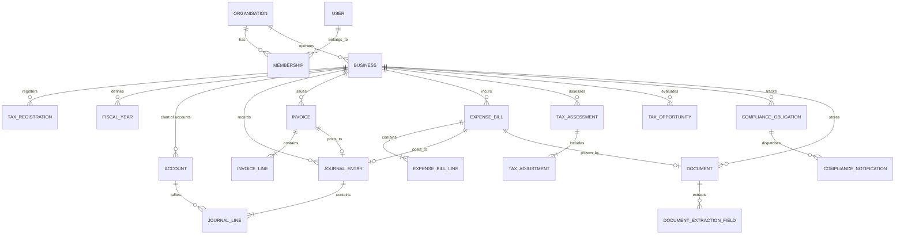

# DATABASE SCHEMA & ENTITY RELATIONSHIP DESIGN (ERD)
## UAE Tax Intelligence Platform
**Document Version:** 1.0.0  
**Target Engine:** PostgreSQL 16+ with `pgvector` & Prisma ORM  
**Architectural Pattern:** Multi-Tenant Isolated Ledger & Deterministic Tax Stores  

---

## 1. Architectural Principles & Data Integrity Rules

1. **Multi-Tenancy Hierarchy**:
   `User` $\rightarrow$ `Membership` $\rightarrow$ `Organisation` (Holding/Accountancy Practice) $\rightarrow$ `Business` (Isolated Legal Person/Trade License). Every single transactional, accounting, and tax query is strictly scoped to `business_id` and enforced via backend session context and PostgreSQL Row-Level Security (RLS).
2. **Double-Entry Ledger Invariants**:
   * All monetary figures use `NUMERIC(18, 4)` to eliminate floating-point rounding errors.
   * `JournalEntry` is immutable once `status = 'POSTED'`. No row updates or deletes permitted.
   * Corrections require a compensating entry (`reversed_by_entry_id` $\leftrightarrow$ `reversal_of_entry_id`).
   * Constraint: $\sum \text{Debit} \equiv \sum \text{Credit}$ enforced within database transactions.
3. **UAE Statutory Alignment**:
   * **Corporate Tax**: Tracks distinct buckets for Natural Person (Cabinet Decision 49/2023 AED 1M threshold), Small Business Relief (MD 73/2023 extended to 2029 for revenue $\le$ AED 3M), and Qualifying Free Zone Person (CD 139/2023 de minimis ratio).
   * **VAT & CBUAE FX Rates**: Non-AED invoices store the exact daily Central Bank of the UAE exchange rate under Article 69 of the VAT Executive Regulations.
   * **RCM**: Cross-border SaaS/service bills store reverse-charge flags impacting Box 3 and Box 10 on the VAT 201 return.
   * **Compliance Deadlines**: Staggered Corporate Tax registration deadlines under FTA Decision No. 3 of 2024 to avert the AED 10,000 late penalty.

---

## 2. High-Level Entity Relationship Diagram (ERD)

---

## 3. Domain Entity Specifications

### 3.1 Identity & Multi-Tenancy Domain
* **User**: Authentication credentials, phone, biometric status, UAE Pass identifier.
* **Organisation**: The legal umbrella. Allows accounting firms to manage dozens of client businesses, or entrepreneurs to manage multi-license holding structures.
* **Membership**: Connects Users to Organisations with granular Role-Based Access Control (`SUPERADMIN`, `ADMIN`, `ACCOUNTANT`, `BOOKKEEPER`, `VIEWER`).
* **Business**: The central entity representing a single UAE Trade License or registered natural person. Stores legal form, mainland vs free zone jurisdiction, licensing authority, and accounting method.

### 3.2 Accounting & Ledger Domain
* **Account (Chart of Accounts)**: Hierarchical account tree adhering to standard UAE financial reporting: Assets (1000s), Liabilities (2000s), Equity (3000s), Revenue (4000s), COGS (5000s), Expenses (6000s).
* **JournalEntry**: Master financial transaction header with strict state machine (`DRAFT` $\rightarrow$ `POSTED` $\rightarrow$ `REVERSED`).
* **JournalLine**: Immutable debit/credit entry with multi-currency tracking and conversion to base currency (`AED`) at CBUAE rate.

### 3.3 Sales, Invoicing & Peppol E-Invoicing Domain
* **Customer**: Customer profile, UAE TRN checksum validation, Free Zone designated flag, foreign residency flag.
* **Invoice**: Tax invoice header supporting Conventional Digital mode and Mode 2 UAE Structured e-Invoicing (Peppol PINT XML status, ASP reference, FTA clearance status).
* **InvoiceLine**: Item description, quantity, unit price, standard 5%, zero-rated 0%, exempt, or out-of-scope tax classification.

### 3.4 Bills, Expenses & Document Intelligence Domain
* **Supplier**: Vendor details, UAE TRN format check, foreign vendor flag (triggers RCM checks for SaaS/imports).
* **ExpenseBill**: Purchase invoice or receipt, payment status, RCM flag, Decision 17/2026 employee expense recovery determination, blocked input VAT flag.
* **Document**: Secure S3 file pointer, MIME type, cryptographic hash, OCR status, and confidence score.
* **DocumentExtractionField**: Raw OCR value vs user-confirmed value with bounding boxes, ensuring pristine audit readiness.

### 3.5 Tax Intelligence & Optimization Domain
* **TaxRegistration**: Stores TRNs for VAT and Corporate Tax, registration effective dates, and deregistration status.
* **TaxAssessment**: Immutable calculation snapshot of CT or VAT position, including gross revenue, taxable income, output VAT, recoverable input VAT, and net liability.
* **TaxAdjustment**: Explicit statutory adjustments (Art. 32 50% entertainment cap, Art. 33 fines/bribes, Art. 30 interest limitation, Art. 21 SBR exemption).
* **TaxOpportunity**: Engine-detected legal savings opportunities (SBR, QFZP 0%, loss relief, input VAT capture) with statutory citation and required evidence list.

### 3.6 Compliance & Obligation Domain
* **ComplianceObligation**: Event-driven obligation tracker mapping FTA Decision No. 3 of 2024 Corporate Tax registration deadlines (calculated via Trade License issuance month to avert the AED 10,000 fine), quarterly VAT 201 return dates, and license expiries.
* **ComplianceNotification**: Staggered alert log (30-day, 14-day, 7-day, 1-day reminders).
