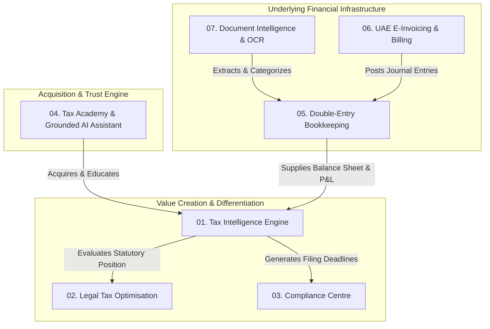
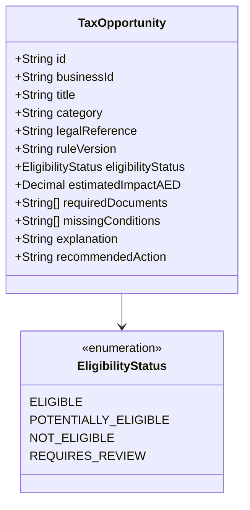
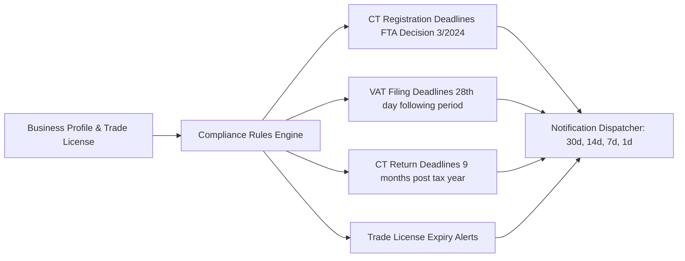
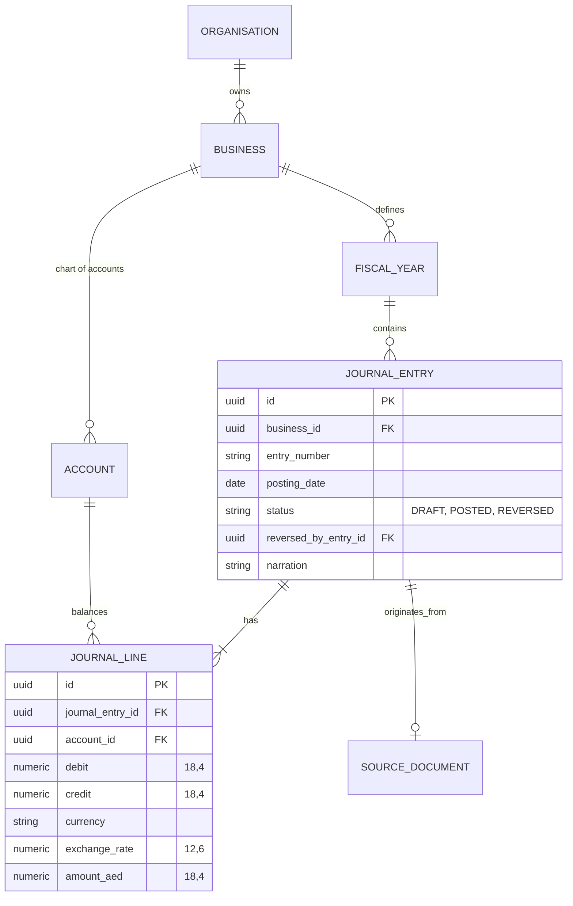

# MASTER PRODUCT REQUIREMENTS DOCUMENT (PRD)
## UAE Tax Intelligence Platform
**Document Version:** 1.0.0  
**Target Platform:** Mobile-First (React Native + Expo) & Extensible Web API (NestJS + PostgreSQL)  
**Status:** Approved for Engineering Architecture  

---

## 1. Executive Summary & Strategic Product Thesis

### 1.1 Product Vision
To build the definitive UAE Tax Intelligence & Financial Management platform that empowers freelancers, sole establishments, SMEs, LLCs, Free Zone entities, and accounting practitioners to understand their tax obligations, automate compliance, maintain audit-proof double-entry books, and legitimately optimize their tax posture under UAE Federal Tax Authority (FTA) laws.

### 1.2 Strategic Hierarchy
Unlike conventional accounting tools that treat tax as an afterthought or an export report, this platform establishes a deliberate product hierarchy:
1. **Tax Intelligence (Core Anchor & Hero Product):** Instant clarity on tax liability, registration obligations, and tax health.
2. **Compliance Centre (Recurring Engagement Engine):** Event-driven obligation tracker preventing severe penalties (e.g., the AED 10,000 late Corporate Tax registration penalty).
3. **Legal Tax Optimisation (Differentiation & Value Engine):** Evidence-backed discovery of legitimate reliefs (Small Business Relief, QFZP 0% regime, R&D/loss carryforwards).
4. **Bookkeeping & Invoicing (Supporting Financial Infrastructure):** Complete, immutable double-entry ledger feeding accurate transactional data into the tax engines.
5. **Tax Academy & Grounded AI Assistant (Acquisition & Retention Engine):** Hyper-personalized education and contextual AI guidance grounded in official UAE statutes.

---

## 2. Target User Personas & Persona-Specific Tax Treatment

The platform explicitly distinguishes between legal structures and natural persons. **The system must never apply identical tax logic across different user categories.**

| Persona Category | Typical Entity Type | Core Pain Points & Statutory Realities | Key Platform Capabilities |
| :--- | :--- | :--- | :--- |
| **P1: Freelancer / Independent Professional** | Natural Person (with or without freelance permit) | Confusion between personal salary vs business turnover. Under **Cabinet Decision No. 49 of 2023**, natural persons are subject to UAE Corporate Tax **only if** UAE business turnover exceeds **AED 1,000,000** within a calendar year (personal employment salary, passive personal investment, and personal real estate income are exempt). | Turnover tracker towards the AED 1M threshold; VAT registration monitor (AED 187.5k / 375k); simple expense scanner. |
| **P2: Sole Establishment** | Natural Person doing business as a sole proprietorship | Unlimited liability; mixed business and personal expenses; VAT registration requirements; Corporate Tax applicability under Decision 49. | Commingled expense separation; VAT return preparation; expense deduction qualification checks. |
| **P3: Mainland SME / LLC** | Juridical Person | Standard 9% Corporate Tax; mandatory or voluntary VAT; Small Business Relief eligibility (**Ministerial Decision No. 73 of 2023**, extended through 31 Dec 2029 for revenue $\le$ AED 3,000,000); strict transfer pricing & related-party rules. | Full double-entry books; SBR election assessment; VAT 201 return generator; Reverse Charge Mechanism (RCM) tracker. |
| **P4: Free Zone Entity** | FZCO / FZL / Free Zone Branch | Qualifying Free Zone Person (QFZP) 0% regime vs 9% standard rate. Complex conditions under **Cabinet Decision No. 139 of 2023** & **Ministerial Decision No. 265 of 2023** (adequate substance, qualifying activities, de minimis test: lower of AED 5M or 5% of total revenue). | QFZP Qualifying Income vs Non-Qualifying Income calculator; de minimis threshold tracking; audited financial readiness. |
| **P5: Accountant / Tax Consultant** | External Advisor / Practice | Managing 10–50+ client entities with disparate financial years, TRNs, and tax obligations. | Multi-tenant organization switcher; client compliance dashboard; batch export of tax audit files (FTA FAF). |

---

## 3. Core Product Modules & Detailed Functional Specifications

### Module 01: Tax Intelligence Engine (Central Calculation Core)
The Tax Intelligence Engine is purely deterministic, executed on the backend using `PostgreSQL NUMERIC` and `decimal.js`.

#### Submodule 1.1: Business Classification Engine
Before any tax calculation runs, the classification pipeline executes:
1. **Legal Person Assessment**: Natural Person vs Juridical Person.
2. **Jurisdiction Assessment**: Mainland vs Free Zone (designated vs non-designated for VAT).
3. **Residency Status**: Resident Person vs Non-Resident Person with a UAE Permanent Establishment (PE) or UAE nexus.
4. **Registration Statuses**: 
   - VAT: Unregistered (monitoring mandatory threshold of AED 375,000 or voluntary of AED 187,500) vs Registered (TRN verified).
   - Corporate Tax: Unregistered (calculating penalty-risk deadline under FTA Decision No. 3 of 2024) vs Registered (Tax Registration Number stored).

#### Submodule 1.2: Corporate Tax (CT) Calculation Engine
* **Statutory Baseline**: Federal Decree-Law No. 47 of 2022 on the Taxation of Corporations and Businesses, amended by subsequent Cabinet & Ministerial Decisions.
* **Calculation Pipeline**:
  $$\text{Accounting Net Profit (IFRS/SME Standard)}$$
  $$\Downarrow$$
  $$\text{Adjustments: Non-deductible expenses (Art. 33) + 50\% Entertainment (Art. 32) + GIDLR Interest Cap (Art. 30)}$$
  $$\Downarrow$$
  $$\text{Less: Exempt Income (Art. 22: Dividends, Participation Exemption Art. 23, Qualifying Foreign PE)}$$
  $$\Downarrow$$
  $$\text{Less: Relieved Income (Small Business Relief Art. 21 / QFZP 0\% Qualifying Income Art. 18)}$$
  $$\Downarrow$$
  $$\text{Less: Allowable Tax Losses carried forward (capped at 75\% of taxable income under Art. 39)}$$
  $$\Downarrow$$
  $$\text{Taxable Income Base}$$
  $$\Downarrow$$
  $$\text{CT Liability} = \begin{cases} 0 & \text{if SBR elected or Taxable Income } \le \text{AED 375,000} \\ 9\% \times (\text{Taxable Income} - \text{AED 375,000}) & \text{if Taxable Income } > \text{AED 375,000} \end{cases}$$

#### Submodule 1.3: Value Added Tax (VAT) Engine
* **Statutory Baseline**: Federal Decree-Law No. 8 of 2017 & Cabinet Decision No. 52 of 2017 (Executive Regulations), updated by 2026 amendments.
* **Tax Supplies Handling**:
  - **Standard-Rated (5%)**: Domestic taxable goods and services.
  - **Zero-Rated (0%)**: Exports outside the GCC implementing states, international transport, qualifying healthcare and education, first supply of residential property within 3 years.
  - **Exempt (0% with No Input Recovery)**: Local passenger transport, financial services (margin/interest-based), bare land, second+ supply of residential real estate.
  - **Out of Scope**: Supplies outside UAE territorial scope.
  - **Reverse Charge Mechanism (RCM - Box 3 & 10)**: Automated classification for cross-border B2B digital services and foreign imports (AWS, Google, SaaS).
  - **Exchange Rate Handling (Art. 69)**: Non-AED invoices are converted using the **Central Bank of the UAE (CBUAE)** daily exchange rate published for the invoice date.

#### Submodule 1.4: Input VAT Recovery Engine
* Integrates **Decision No. 17 of 2026** on employee expenses.
* Deterministic classification matrix:
  - **Fully Recoverable**: 100% used for making taxable supplies.
  - **Blocked (Non-recoverable under Art. 53)**: Client entertainment, personal motor vehicles used privately, medical insurance for family/dependents exceeding statutory emirate mandates.
  - **Partially Recoverable**: Apportioned using input tax apportionment methods (standard input recovery ratio).

---

### Module 02: Legal Tax Optimisation Engine
The optimization engine detects legitimate structural and statutory savings, surfacing actionable opportunities backed by legal references:

#### Core Opportunity Rules Catalog
1. **Small Business Relief (Art. 21 / MD 73 of 2023 extended to 2029)**:
   - *Condition*: Revenue $\le$ AED 3,000,000 for current and prior tax periods; not a QFZP; not an MNE group entity.
   - *Impact*: 0% tax liability on entire profit; simplified compliance without taxable adjustments.
2. **Qualifying Free Zone Person (QFZP - Art. 18 / CD 139 of 2023)**:
   - *Condition*: Located in Free Zone; maintains adequate substance; derives qualifying income from qualifying activities or transactions with other FZ persons; satisfies de minimis (non-qualifying revenue $\le \min(\text{AED 5,000,000}, 5\% \times \text{Total Revenue})$); prepares audited financials.
   - *Impact*: 0% rate on qualifying income.
3. **Tax Loss Carryforward (Art. 37 & 39)**:
   - *Condition*: Unutilized tax losses from prior tax periods with $>50\%$ ownership continuity.
   - *Impact*: Offset up to 75% of taxable income in current period.
4. **Legitimate Business Deductions Review (Art. 28)**:
   - *Condition*: Business expenses incurred wholly and exclusively for business purposes with valid supporting invoices. Flags commingled sole-proprietor expenses for legitimate reclassification.
5. **Reverse Charge Input Recovery Validation**:
   - Ensures all imported service reverse charge tax amounts (Box 3) are matched with corresponding input tax recovery in Box 10, preventing inadvertent unrecovered input tax leakage.

---

### Module 03: Compliance Centre (Event-Driven Obligation Engine)

The Compliance Centre actively monitors entity metadata and calculates statutory deadlines, alert cadences, and penalty exposures:

#### Staggered Corporate Tax Registration Schedule (FTA Decision No. 3 of 2024)
The engine automatically evaluates the Trade License issuance month and generates countdown timers with severe penalty alerts (**AED 10,000** for failure to apply within deadline):

| Trade License Month (Regardless of Year Issued) | Statutory Deadline to Submit CT Registration |
| :--- | :--- |
| January or February | 31 May 2024 |
| March or April | 30 June 2024 |
| May | 31 July 2024 |
| June | 31 August 2024 |
| July | 30 September 2024 |
| August or September | 31 October 2024 |
| October or November | 30 November 2024 |
| December | 31 December 2024 |
| Persons without a license on 1 March 2024 | 31 May 2024 (or 3 months from incorporation) |

---

### Module 04: Accounting & Double-Entry Bookkeeping Engine

Every financial transaction posted in the app updates an **immutable double-entry General Ledger**.
* **Zero Deletions**: Posted journals cannot be deleted. Any correction is executed via an explicit reversing journal entry linked to the original entry ID.
* **Balanced Books Guarantee**: $\sum \text{Debits} \equiv \sum \text{Credits}$ checked at the database constraint level.

#### Standard Chart of Accounts (UAE Compliant Preset)
1. **1000 - Assets**: Cash and Cash Equivalents, Accounts Receivable, Input VAT Recoverable (1150), Fixed Assets, Accumulated Depreciation.
2. **2000 - Liabilities**: Accounts Payable, Output VAT Payable (2150), Corporate Tax Provision (2200), Accrued Expenses, Owner's Drawings.
3. **3000 - Equity**: Share Capital, Retained Earnings, Current Year Earnings.
4. **4000 - Revenue**: Sales Revenue (Standard Rated 5%), Zero-Rated Sales, Exempt Sales, Out-of-Scope Income.
5. **5000 - Cost of Goods Sold**: Direct Materials, Subcontractor Costs, Freight.
6. **6000 - Operating Expenses**: Rent, Salaries & Employee Benefits, Utilities, Software & SaaS Subscriptions (RCM Applicable), Marketing & Advertising, Client Entertainment (50% CT Deductible Cap), Legal & Professional Fees, Bank Charges, Depreciation.

---

### Module 05: Invoicing & Billing Engine

The Invoicing system operates in two concurrent modes:
1. **Mode 1: Conventional Digital Invoicing**:
   - PDF creation with QR codes, TRN validation, line-item VAT breakdown, multi-currency conversion to AED at CBUAE rate, and email dispatch.
2. **Mode 2: UAE Structured e-Invoicing (Peppol 5-Corner Model Integration)**:
   - Data mapping from the internal invoice model to the official UAE PINT e-Invoice data dictionary (UBL 2.1 XML / JSON format).
   - Integration hook with an Accredited Service Provider (ASP) API to handle transmission, validation, buyer-side delivery, and FTA clearance reporting.

---

### Module 06: Tax Academy & Grounded AI Assistant

#### RAG Architecture & Guardrails
* **Statutory Knowledge Base**: Full-text & vector indexed (`pgvector`) repository of UAE Federal Decree-Laws, Cabinet Decisions, Ministerial Decisions, and FTA Public Clarifications.
* **Strict Non-Hallucination Policy**:
  - The AI assistant **never performs arithmetic tax calculations**; it calls backend calculation services.
  - The AI assistant **must cite official sources** (e.g., *"Under Article 33(1) of Federal Decree-Law No. 47 of 2022..."*).
  - Mode Switcher:
    - **Learn Mode**: Explains concepts and rules.
    - **Analyse Mode**: Reads user’s redacted financial stats and explains current liability.
    - **Guide Mode**: Interactive questionnaire to prepare for filing.

---

## 4. Mobile Information Architecture & Screen Inventory

The mobile interface is designed around a 5-tab bottom navigation bar:

```mermaid
graph TD
    Root[App Root] --> Nav[5-Tab Navigation Bar]
    Nav --> TabHome[1. Home / Dashboard]
    Nav --> TabTax[2. Tax Intelligence]
    Nav --> TabBooks[3. Books & Ledger]
    Nav --> TabLearn[4. Tax Academy & AI]
    Nav --> TabProfile[5. Profile & Settings]

    TabHome --> SCR_H1[Business Overview]
    TabHome --> SCR_H2[Estimated CT / VAT Summary]
    TabHome --> SCR_H3[Top Tax Opportunities]
    TabHome --> SCR_H4[Upcoming Deadlines & Compliance Score]

    TabTax --> SCR_T1[Corporate Tax Dashboard]
    TabTax --> SCR_T2[VAT 201 Return Workspace]
    TabTax --> SCR_T3[Tax Optimisation Center]
    TabTax --> SCR_T4[Tax Health Score & Report]

    TabBooks --> SCR_B1[Financial Overview P&L]
    TabBooks --> SCR_B2[Sales & Invoicing]
    TabBooks --> SCR_B3[Expenses & Bill Scanner]
    TabBooks --> SCR_B4[Chart of Accounts & General Ledger]

    TabLearn --> SCR_L1[Learning Paths & Courses]
    TabLearn --> SCR_L2[AI Tax Assistant Chat]
    TabLearn --> SCR_L3[Legislation & Public Clarification Vault]

    TabProfile --> SCR_P1[Multi-Business Profile Switcher]
    TabProfile --> SCR_P2[Trade License & TRN Records]
    TabProfile --> SCR_P3[Compliance Rules Preferences]
```

### Screen Inventory by Tab

#### Tab 1: Home
* `SCR-H01`: **Dashboard**: Real-time CT liability card, Net VAT payable card, Revenue vs Expense trends, Compliance health badge (0–100 score).
* `SCR-H02`: **Quick Action Sheet**: "Scan Expense", "Create Tax Invoice", "Run CT Assessment", "Ask AI".
* `SCR-H03`: **Urgent Alerts Drawer**: Pending deadlines, missing documents, unverified TRNs.

#### Tab 2: Tax Intelligence
* `SCR-T01`: **Tax Overview Hub**: Toggle between Corporate Tax and VAT views.
* `SCR-T02`: **Corporate Tax Dashboard**: Taxable income breakdown, SBR status pill, QFZP de minimis gauge, relief tracker.
* `SCR-T03`: **VAT 201 Workspace**: Boxes 1–14 mapped to live ledger data, standard/zero/exempt breakdown, reverse charge matching.
* `SCR-T04`: **Input VAT Recovery Reviewer**: Expense classification interface with Decision 17/2026 rules checker.
* `SCR-T05`: **Tax Optimization Opportunity Detail**: Explanation, legal reference citation, potential AED savings, and checklist of required documents.
* `SCR-T06`: **Tax Health Report (Exportable PDF)**: Comprehensive audit readiness score and risk flags.

#### Tab 3: Books (Financial Infrastructure)
* `SCR-B01`: **Books Dashboard**: Cash position, accounts receivable aging, accounts payable aging.
* `SCR-B02`: **Invoices List & Create**: Tax invoice builder with auto-VAT calculation, CBUAE foreign exchange conversion, PDF generator, and e-Invoice status.
* `SCR-B03`: **Expense Scanner & Review**: Native camera/document picker, multi-page scanning, real-time OCR extraction review, TRN format validator.
* `SCR-B04`: **Chart of Accounts & Ledger**: Drill-down from accounts to posted journal lines.
* `SCR-B05`: **Financial Reports**: Balance Sheet, Profit & Loss, Trial Balance with date range filtering.

#### Tab 4: Learn (Education & AI)
* `SCR-L01`: **Academy Hub**: Learning paths ("Corporate Tax 101", "Mastering VAT Recovery", "Freelancer Tax Survival").
* `SCR-L02`: **Interactive Lesson Screen**: Bite-sized interactive cards with retention quizzes.
* `SCR-L03`: **AI Tax Assistant**: Conversational chat interface with grounded citations, suggested prompts, and context-aware responses based on user’s business profile.
* `SCR-L04`: **Official UAE Legislation Library**: Searchable database of Decree-Laws, Cabinet Decisions, and Guides.

#### Tab 5: Profile & Settings
* `SCR-P01`: **Business Switcher**: Seamless switching between multiple trade licenses / business profiles (for founders with multiple entities or accountants).
* `SCR-P02`: **Business Profile & Document Vault**: License number, issuing authority, expiry date, VAT TRN, CT TRN, financial year dates.
* `SCR-P03`: **Team & Role-Based Access Control**: Admin, Accountant, Bookkeeper, Viewer.
* `SCR-P04`: **Security & Privacy Settings**: Biometric lock (Face ID/Touch ID), UAE PDPL data export, session manager.

---

## 5. Non-Functional Requirements & Compliance Architecture

### 5.1 Data Precision & Integrity
* **No Floating-Point Math**: All financial and tax math must use exact decimal structures (`PostgreSQL NUMERIC(18, 4)` and `decimal.js`).
* **Audit Trail**: Every database mutation on accounts, invoices, and tax parameters must log `created_by`, `timestamp`, `ip_address`, `before_state`, and `after_state`.
* **Idempotency**: All payment and journal posting API endpoints require an `Idempotency-Key` header to prevent double-postings.

### 5.2 Performance Targets
* **App Cold Launch**: $< 2.0$ seconds on 4G networks.
* **UI Frame Rate**: Constant 60 FPS transitions using React Native Reanimated 3.
* **Dashboard Data Load**: $< 500$ ms using cached TanStack Query states with stale-while-revalidate.
* **Document OCR Processing**: Synchronous edge feedback within 1.5 seconds; full background extraction and VAT categorization within 5.0 seconds.

### 5.3 Security & UAE Regulatory Governance
* **UAE Personal Data Protection Law (Federal Decree-Law No. 45 of 2021)** compliance: Explicit user consent for data processing, localized encrypted storage, right to erasure and export.
* **Document Security**: All business documents and receipts stored in private S3-compatible buckets with client-side signed URLs expiring in $< 15$ minutes.
* **No Government Portal Password Storing**: The platform adopts an **assisted workflow model**. It will never store EmaraTax passwords or attempt automated headless scraping of UAE government portals.

---

## 6. Implementation Phasing & MVP Acceptance Criteria

### Phase 1: MVP Release Scope (Weeks 1–8)
1. **Onboarding & Business Intelligence**:
   - Phone/Email authentication with biometric lock.
   - User classification (Freelancer, Sole Establishment, LLC, Free Zone).
   - Trade license upload with automated OCR field extraction.
2. **Deterministic Tax Intelligence**:
   - Corporate Tax liability calculator with Small Business Relief check.
   - VAT liability calculator with threshold progress bar.
   - Staggered Corporate Tax registration deadline countdown with AED 10k penalty alert.
3. **Core Document Processing**:
   - Single-page and multi-page expense receipt scanning.
   - TRN validation against UAE FTA checksum pattern (15 digits, starts with 100).
   - Automated Decision 17/2026 expense categorization.
4. **Basic Books**:
   - Simplified double-entry ledger running in background.
   - Income and expense manual entry.
5. **Grounded AI Assistant**:
   - Tax legislation Q&A with direct citation of UAE Decree-Laws and Cabinet Decisions.

### MVP Acceptance Criteria
* [x] Trade license scan extracts legal name, license number, jurisdiction, and expiry with $\ge 90\%$ accuracy.
* [x] CT calculation correctly identifies natural persons earning $< \text{AED } 1\text{M}$ as non-taxable under Decision 49.
* [x] Corporate Tax liability for companies under AED 3,000,000 revenue flags Small Business Relief eligibility and displays zero liability.
* [x] Non-recoverable expenses (e.g., entertainment) are automatically segregated into 50% CT deductible and 0% VAT input recovery buckets.
* [x] All accounting entries balance ($\text{Debit} \equiv \text{Credit}$) before database commit.
