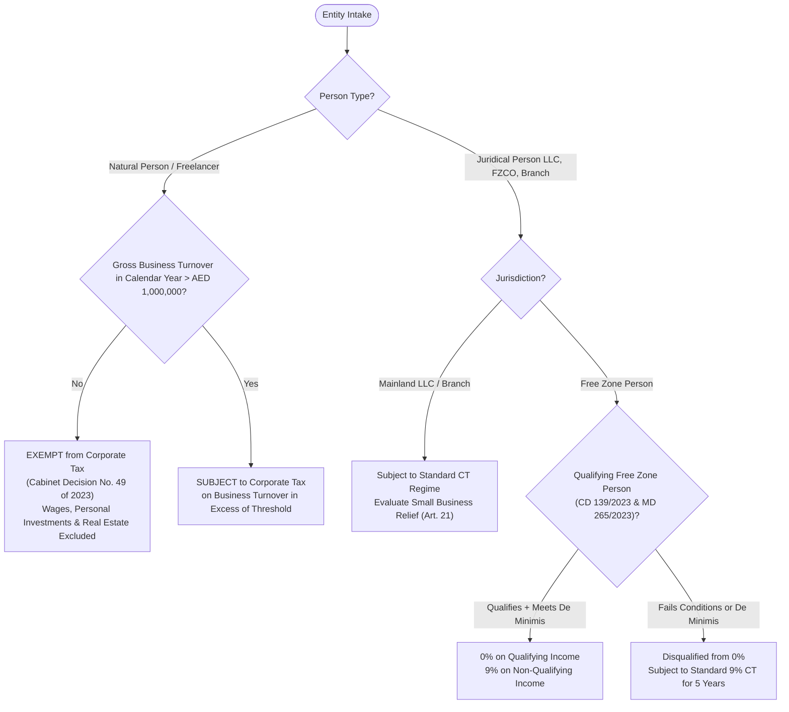
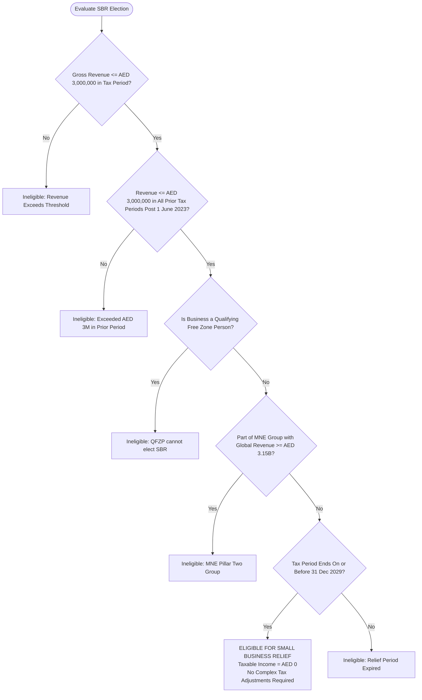
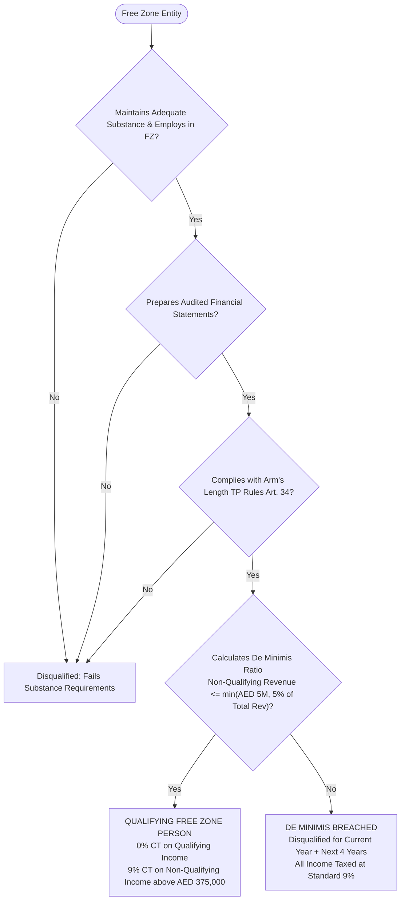
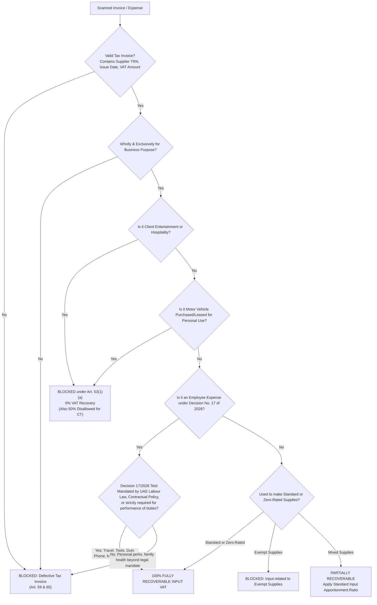

# TAX ENGINE SPECIFICATION & CALCULATION LOGIC
## UAE Tax Intelligence Platform
**Document Version:** 1.0.0  
**Statutory Framework:** Federal Decree-Law No. 47 of 2022 (Corporate Tax), Federal Decree-Law No. 8 of 2017 (VAT), Cabinet Decisions, Ministerial Decisions (including 2026 amendments)  
**Execution Environment:** Deterministic Backend Service (`decimal.js` / PostgreSQL `NUMERIC`)  

---

## 1. Architectural Philosophy & Engine Invariants

1. **Zero LLM Arithmetic**: All tax liabilities, adjustments, thresholds, and apportionments are computed deterministically. The AI layer is strictly downstream—consuming calculation output payloads to explain results to users in plain language.
2. **Arbitrary Precision Arithmetic**: All financial calculations must execute using `decimal.js` (rounding mode: `ROUND_HALF_UP`, precision: 18 digits with 4 decimal places). JavaScript IEEE 754 floating-point arithmetic is forbidden.
3. **Statutory Versioning**: Every calculation result is stamped with a `ruleSetVersion` (e.g., `2026.1-CT`, `2026.2-VAT`) and stores an immutable snapshot of all inputs, adjustments, legal references, and assumptions.
4. **Audit Reproducibility**: Given the exact same financial records and business metadata, the engine must reproduce identical output to the fils.

---

## 2. Business Classification & Applicability Pipeline

Before running any tax arithmetic, the engine determines the legal tax personality of the entity:



### 2.1 Natural Person vs Business Income Rules (Cabinet Decision No. 49 of 2023)
For natural persons (freelancers, sole proprietors without separate legal personality):
* **Taxable Income Scope**: Only turnover derived from commercial, industrial, or professional business activities conducted under a license/permit in the UAE.
* **Exempt Income Categories**:
  1. Employment wages and salaries (MOHRE contracts or equivalent).
  2. Personal investment income (dividends, capital gains from personal investments not conducted through a commercial license).
  3. Real estate investment income (rental income or sale proceeds from personally owned properties).
* **Threshold Condition**: Gross turnover from business activities must exceed **AED 1,000,000** in a calendar year before Corporate Tax registration and liability apply.

---

## 3. Corporate Tax (CT) Calculation Engine

### 3.1 Mathematical Pipeline

$$\text{Accounting Net Profit (Audited / Accrual / SME IFRS)}$$
$$\Downarrow$$
$$+ \text{ Non-Deductible Fines \& Penalties (Art. 33(1))}$$
$$+ \text{ Bribes \& Illicit Payments (Art. 33(2))}$$
$$+ \text{ Dividends \& Profit Distributions to Owners (Art. 33(3))}$$
$$+ \text{ Recoverable Input VAT (Art. 33(4))}$$
$$+ \text{ 50\% of Client Entertainment \& Hospitality Expenses (Art. 32)}$$
$$+ \text{ Disallowed Net Interest Expense above 30\% EBITDA (Art. 30)}$$
$$- \text{ Exempt Dividend \& Capital Gain Income (Art. 22 \& 23)}$$
$$- \text{ Qualifying Foreign Permanent Establishment Profits (Art. 24)}$$
$$\Downarrow$$
$$= \text{Taxable Income Before Reliefs}$$
$$\Downarrow$$
$$\text{If Small Business Relief Elected (Art. 21) } \rightarrow \text{Taxable Income} = \text{AED 0}$$
$$\text{Else: Offset Allowable Prior Year Tax Losses (Capped at 75\% of current Taxable Income)}$$
$$\Downarrow$$
$$= \text{Final Taxable Income}$$
$$\Downarrow$$
$$\text{Corporate Tax Payable} = \begin{cases} 
\text{AED 0} & \text{if Final Taxable Income } \le \text{AED 375,000} \\
9\% \times (\text{Final Taxable Income} - \text{AED 375,000}) & \text{if Final Taxable Income } > \text{AED 375,000}
\end{cases}$$

---

### 3.2 Small Business Relief (SBR) Decision Engine



* **Statutory Basis**: Article 21 of Federal Decree-Law No. 47 of 2022, Ministerial Decision No. 73 of 2023, and the official Ministry of Finance August 2026 extension to tax periods ending on or before **31 December 2029**.
* **Engine Consequences**: When SBR is elected, all transfer pricing documentation, tax adjustments, and interest caps are waived. The liability is strictly AED 0, and tax losses cannot be carried forward from an SBR tax period.

---

### 3.3 Qualifying Free Zone Person (QFZP) & De Minimis Engine

For businesses incorporated in UAE Free Zones:



* **Statutory Formula for De Minimis**:
  $$\text{De Minimis Limit} = \min(\text{AED 5,000,000}, \ 0.05 \times \text{Total Revenue})$$
  $$\text{If Non-Qualifying Revenue} \le \text{De Minimis Limit} \rightarrow \text{Qualifying Status Maintained}$$
  $$\text{If Non-Qualifying Revenue} > \text{De Minimis Limit} \rightarrow \text{Loss of QFZP Status for 5 Years}$$

---

### 3.4 General Interest Deduction Limitation Rule (GIDLR - Art. 30)

* **De Minimis Threshold**: If Net Interest Expense $\le$ **AED 12,000,000** (Ministerial Decision No. 126 of 2023), the entire interest expense is fully deductible without applying the 30% limitation.
* **Calculation when Net Interest Expense $>$ AED 12,000,000**:
  $$\text{Tax EBITDA} = \text{Taxable Income (before interest, tax, depreciation, and amortization)}$$
  $$\text{Max Allowable Interest Deduction} = \max(\text{AED 12,000,000}, \ 0.30 \times \text{Tax EBITDA})$$
  $$\text{Disallowed Interest Adjustment} = \max(0, \ \text{Net Interest Expense} - \text{Max Allowable Interest Deduction})$$
  *(Disallowed interest may be carried forward for up to 10 subsequent tax periods).*

---

## 4. Value Added Tax (VAT) Calculation Engine

### 4.1 VAT Return 201 Box Mapping Matrix

Every transaction in the ledger is mapped directly to the statutory FTA VAT 201 Return boxes:

| Return Box | Description | Transaction Criteria | Rate / Formula |
| :---: | :--- | :--- | :---: |
| **Box 1** | Standard-Rated Supplies by Emirate | Domestic sales of taxable goods/services allocated to the establishment emirate | 5% Output VAT |
| **Box 2** | Tax Refunds to Tourists Scheme | Authorized retail tourist refund scheme deductions | Calculated adjustment |
| **Box 3** | Supplies Subject to the Reverse Charge | Cross-border imported services (e.g., AWS, OpenAI, Google Workspace, foreign contractors) | 5% Deemed Output VAT |
| **Box 4** | Zero-Rated Supplies | Export of goods/services outside GCC, international transport, qualifying healthcare/education | 0% VAT |
| **Box 5** | Exempt Supplies | Local passenger transport, residential leases, margin-based financial services | 0% (No Input Recovery) |
| **Box 6** | Goods Imported into the UAE | Customs declarations cleared through UAE ports (imported goods via customs TRN linkage) | 5% via FTA Customs match |
| **Box 7** | Adjustments to Goods Imported | Corrections/discrepancies between customs declarations and accounting records | Adjustment amount |
| **Box 8** | **Total Value of Due Tax** | $\sum \text{Output VAT (Boxes 1, 2, 3, 6, 7)}$ | **Total Output VAT** |
| **Box 9** | Standard-Rated Expenses | Domestic purchases with a valid Tax Invoice containing supplier TRN | Recoverable Input VAT |
| **Box 10** | Supplies Subject to the Reverse Charge | Corresponding input VAT recovery on imported services declared in Box 3 | Recoverable Input VAT |
| **Box 11** | **Total Value of Recoverable Tax** | $\sum \text{Recoverable Input VAT (Boxes 9 + 10)}$ | **Total Recoverable VAT** |
| **Box 12** | **Net Payable or Refundable Tax** | $\text{Box 8 (Due Tax)} - \text{Box 11 (Recoverable Tax)}$ | **Net VAT Position** |

---

### 4.2 Decision No. 17 of 2026 & Input VAT Recovery Engine



---

## 5. TypeScript Engine Architecture & Interfaces

The executable contracts implemented in `@backend/tax-engine`:

```typescript
import { Decimal } from 'decimal.js';

// Configuration
Decimal.set({ precision: 18, rounding: Decimal.ROUND_HALF_UP });

export type LegalEntityType = 
  | 'NATURAL_PERSON' 
  | 'SOLE_ESTABLISHMENT' 
  | 'LLC' 
  | 'FREE_ZONE_ESTABLISHMENT' 
  | 'FREE_ZONE_COMPANY';

export interface BusinessTaxContext {
  businessId: string;
  legalEntityType: LegalEntityType;
  isMainland: boolean;
  isDesignatedFreeZone: boolean;
  isQfzpEligible: boolean;
  vatRegistered: boolean;
  corporateTaxRegistered: boolean;
  annualTurnoverAED: Decimal;
  employmentSalaryAED?: Decimal; // Excluded for Natural Persons under CD 49/2023
  personalInvestmentIncomeAED?: Decimal; // Excluded for Natural Persons
}

export interface CorporateTaxCalculationInput {
  taxPeriodStart: Date;
  taxPeriodEnd: Date;
  accountingNetProfit: Decimal;
  revenueAED: Decimal;
  priorPeriodRevenues: Decimal[]; // To verify SBR continuity <= AED 3M
  isSmallBusinessReliefElected: boolean;
  nonDeductibleFines: Decimal;
  clientEntertainmentExpense: Decimal; // Subject to 50% cap
  netInterestExpense: Decimal;
  taxEbitda: Decimal;
  exemptDividendsAndGains: Decimal;
  qualifyingForeignPeProfit: Decimal;
  unutilizedPriorTaxLosses: Decimal;
  isQfzp: boolean;
  qfzpQualifyingIncome?: Decimal;
  qfzpNonQualifyingIncome?: Decimal;
}

export interface TaxAdjustmentItem {
  code: string;
  label: string;
  statutoryReference: string;
  amountAED: Decimal;
  isAdditionToProfit: boolean;
  rationale: string;
}

export interface CorporateTaxCalculationResult {
  ruleSetVersion: string;
  accountingNetProfit: Decimal;
  totalAdditions: Decimal;
  totalSubtractions: Decimal;
  taxableIncomeBeforeLosses: Decimal;
  taxLossOffsetApplied: Decimal;
  remainingTaxLosses: Decimal;
  finalTaxableIncome: Decimal;
  isSmallBusinessReliefApplied: boolean;
  taxPayableAED: Decimal;
  effectiveTaxRatePct: Decimal;
  adjustments: TaxAdjustmentItem[];
  warnings: string[];
}
```

---

## 6. Comprehensive Test Suite Matrix (12 Core Statutory Scenarios)

These 12 scenarios serve as the deterministic unit test criteria for the backend test runner (`tax-engine.spec.ts`):

| Test ID | Scenario Description | Key Statutory Mechanics | Expected Output |
| :---: | :--- | :--- | :--- |
| **TC-01** | **Freelancer with High Employment Salary** | Natural person with AED 1.5M employment salary + AED 400k freelance income. Cabinet Decision 49/2023 excludes salary. Business turnover AED 400k $<$ AED 1M. | **Corporate Tax Exempt.** Taxable Income = 0, CT Payable = 0. |
| **TC-02** | **Freelancer Crossing AED 1M Turnover** | Natural person with AED 1.2M gross consulting turnover. Net profit AED 600,000. No prior years. SBR not elected. | **Subject to CT.** First AED 375k at 0%, remaining AED 225k at 9% = **AED 20,250 CT Payable**. |
| **TC-03** | **Mainland LLC with Small Business Relief** | LLC with AED 2.8M revenue and AED 500,000 profit. SBR elected. Prior period revenue AED 2.5M. | **SBR Applied.** Final Taxable Income = 0, **CT Payable = AED 0**. No tax adjustments required. |
| **TC-04** | **Mainland LLC Breaching SBR Prior Threshold** | Current revenue AED 2.0M, but Year 1 revenue was AED 3.2M. SBR disqualified due to prior period breach. | **SBR Disqualified.** Standard 9% regime applies on taxable profit exceeding AED 375,000. |
| **TC-05** | **Mainland LLC with 50% Entertainment Cap** | Accounting profit AED 1,000,000. Incurred AED 100,000 in client hospitality (Art. 32). Fines of AED 20,000 (Art. 33). | Additions: AED 50,000 (50% entertainment) + AED 20,000 (fines). Taxable income = AED 1,070,000. **CT Payable = 9% $\times$ (1,070,000 - 375,000) = AED 62,550**. |
| **TC-06** | **Interest Limitation Cap (GIDLR)** | Net interest expense AED 15,000,000. Tax EBITDA AED 30,000,000. Max 30% cap = AED 9,000,000. De minimis AED 12M applies. | Disallowed interest = $15\text{M} - \max(12\text{M}, 9\text{M}) = \text{AED 3,000,000}$ added back to taxable income. |
| **TC-07** | **75% Tax Loss Utilization Cap** | Current taxable income AED 1,000,000. Unutilized prior losses AED 1,200,000. Art. 39 caps loss offset at 75%. | Loss utilized = AED 750,000. Remaining taxable income = AED 250,000 ($\le 375\text{k} \rightarrow \text{CT} = 0$). Unutilized losses carried forward = AED 450,000. |
| **TC-08** | **QFZP Passing De Minimis Test** | FZ entity with AED 10,000,000 total revenue. Non-qualifying revenue = AED 400,000. De minimis limit = $\min(5\text{M}, 5\% \times 10\text{M}) = \text{AED 500,000}$. | **QFZP Status Valid.** Non-qualifying revenue ($\text{AED 400k} \le \text{AED 500k}$) satisfies test. 0% applied on qualifying income. |
| **TC-09** | **QFZP Breaching De Minimis Test** | FZ entity with AED 10,000,000 total revenue. Non-qualifying revenue = AED 600,000 (exceeds AED 500k de minimis limit). | **QFZP Disqualified.** Entire net profit taxed at standard 9%. Penalty status logged for next 4 years. |
| **TC-10** | **Foreign SaaS Reverse Charge Mechanism (RCM)** | UAE business purchases USD 10,000 in AWS cloud hosting. CBUAE exchange rate on invoice date = 3.6725. | AED base = AED 36,725. Output VAT Box 3 = AED 1,836.25. Recoverable Input VAT Box 10 = AED 1,836.25. **Net cash impact = AED 0**. |
| **TC-11** | **Decision No. 17 of 2026 Employee Expenses** | Staff business travel hotel = AED 10,000 (+500 VAT). Client entertainment dinner = AED 2,000 (+100 VAT). | Hotel VAT (AED 500) = **100% Recoverable**. Dinner VAT (AED 100) = **0% Recoverable (Blocked)** under Art. 53. |
| **TC-12** | **CBUAE Article 69 Currency Conversion** | Invoice issued in EUR 1,000. CBUAE rate = 3.9821. Commercial bank spot rate = 4.0200. | Engine strictly enforces CBUAE rate: Line total = AED 3,982.10. VAT (5%) = **AED 199.11**. Commercial spot rate rejected. |
