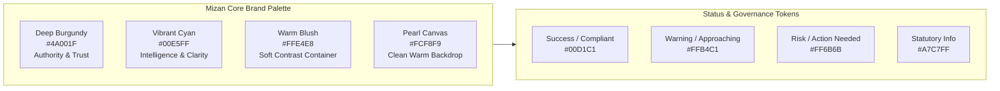
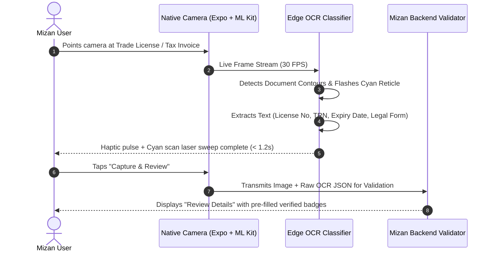

# UI/UX IMPLEMENTATION SPECIFICATION
## Mizan (ميزان) — UAE Tax Intelligence Platform
**App Identity:** Mizan (ميزان)  
**Tagline:** Understand your taxes. Manage your finances. Stay compliant.  
**Target Platform:** Mobile-First (React Native + Expo Dev Client)  
**Theme Mode:** Warm Light Theme (Deep Burgundy, Blush, Vibrant Cyan, Pearl Canvas)  
**Localization:** Dual English & Arabic (RTL) from Day 1  
**Vision Engine:** On-device edge OCR (Google ML Kit / Apple Vision) with backend validation  

---

## 1. Brand Identity & Design Token Architecture



### 1.1 Color Tokens Specification

| Token Name | Hex Code | Opacity / Tint | Application |
| :--- | :---: | :---: | :--- |
| `color.brand.burgundy` | `#4A001F` | 100% | Primary CTA buttons, navbar headers, active tab icons, brand title |
| `color.brand.burgundyDark` | `#360016` | 100% | Pressed states, card header gradients, dark badge text |
| `color.brand.cyan` | `#00E5FF` | 100% | Scanner reticle laser beam, interactive gauges, chart accents, pill highlights |
| `color.brand.cyanMuted` | `#00D1C1` | 100% | Success state indicator, compliant checkmarks, safe liability badges |
| `color.brand.blush` | `#FFE4E8` | 100% | Pill container backgrounds, card borders, badge backdrops |
| `color.brand.blushSoft` | `#FFF5F7` | 100% | Input field background, subdued card surface, table alternate rows |
| `color.semantic.success` | `#00D1C1` | 100% | "Likely Compliant", "TRN Verified", "SBR Eligible" |
| `color.semantic.warning` | `#FFB4C1` | 100% | "Approaching Threshold", "Review Required", "Pending Invoice" |
| `color.semantic.risk` | `#FF6B6B` | 100% | "AED 10k Penalty Risk", "Late Registration Deadline", "Blocked VAT" |
| `color.semantic.info` | `#A7C7FF` | 100% | "Art. 21 Reference", "CBUAE Rate Applied", "Decision 17 Note" |
| `color.neutral.canvas` | `#FCF8F9` | 100% | App-wide screen background |
| `color.neutral.surface` | `#FFFFFF` | 100% | Primary card surface, sheet background, dialog containers |
| `color.neutral.border` | `#EFE7E9` | 100% | Card borders, table cell dividers, input outlines |
| `color.neutral.textPrimary` | `#1C0D12` | 100% | High-contrast body text, primary figures, headlines |
| `color.neutral.textSecondary`| `#6E5D63` | 100% | Captions, metadata, statutory article numbers, subtitle text |

---

## 2. Bilingual & RTL Architecture (Day 1 English / العربية)

Mizan natively supports dual-language operation with instant dynamic direction flipping:

```mermaid
graph TD
    AppLocale[Mizan Locale Engine] -->|User Selects English| LTR[LTR Layout Engine: Inter Font]
    AppLocale -->|User Selects العربية| RTL[RTL Layout Engine: Cairo / Noto Sans Arabic]

    LTR --> NavLTR[Tabs: Home -> Tax -> Books -> Learn -> Profile]
    RTL --> NavRTL[Tabs: الحساب -> تعلم -> الدفاتر -> الضرائب -> الرئيسية]

    LTR --> AlignmentLTR[Left: Icons & Labels | Right: Values & Chevron >]
    RTL --> AlignmentRTL[Right: Icons & Labels | Left: Values & Chevron <]
```

### 2.1 Font Pairing & Typography System
* **English Typography**: `Inter` (`500 Medium`, `600 SemiBold`, `700 Bold`)
* **Arabic Typography**: `Cairo` or `Noto Sans Arabic` (`500 Medium`, `600 SemiBold`, `700 Bold`)
* **Numeric Typography**: For financial figures, the app uses Western Arabic numerals (`1, 2, 3...`) in both language modes for consistency with UAE banking and FTA EmaraTax portals, with Arabic labels (e.g., `45,000 د.إ`).
* **Layout Mirroring**: All flexbox containers use logical properties (`start`, `end`, `marginHorizontal`, `paddingHorizontal`) rather than hardcoded `left`/`right`.

---

## 3. On-Device Google ML Kit Scanner & Review Experience

The Document Scanner is engineered for sub-second, on-device OCR feedback using the camera frame processor:



### 3.1 Scanner Screen (`SCR-SCAN`) Layout Specification
1. **Top Bar**: Transparent overlay with Close (X) button, Torch toggle, and Flash mode.
2. **Camera Viewport**: High-resolution feed with a **Cyan bounding box (`#00E5FF`)** and rounded corners (`radii.lg`).
3. **Animated Laser Sweep**: React Native Reanimated loop sweeping a horizontal cyan gradient beam (`#00E5FF` $\rightarrow$ transparent) across the reticle.
4. **Edge Extraction HUD**: Real-time pill chip floating above camera:
   * Detecting: *"Align Trade License within frame"*
   * Found: *"Trade License Number Detected: 1234567"* (Green badge `#00D1C1`)
5. **Bottom Shutter Bar**:
   * Left: Gallery picker button (upload existing PDF or JPG).
   * Center: Deep Burgundy shutter button (`#4A001F`) with white ring.
   * Right: Manual entry fallback button.

### 3.2 Review Details Screen (`SCR-REV`) Layout Specification
* Clean white cards displaying each extracted field:
  * **Trade Licence No**: Editable input with pen icon and status chip (*Extracted*).
  * **Business Legal Name**: Arabic and English business name.
  * **Legal Form**: Dropdown selector (`LLC`, `Sole Establishment`, `Free Zone FZCO`).
  * **Licensing Authority & Jurisdiction**: (`Mainland (DET Dubai)`, `ADGM`, `DMCC`, etc.).
  * **Issue Date & Expiry Date**: Date pickers pre-filled from OCR.
* **Sticky Bottom Bar**: Full-width Deep Burgundy CTA (`#4A001F`): **Confirm & Continue $\rightarrow$**

---

## 4. 5-Tab Navigation & Complete Screen Architecture

```mermaid
graph TD
    MizanApp[Mizan Mobile Application] --> TabBar[5-Tab Floating Bottom Navigation Bar]
    
    TabBar --> Tab1["1. Home (الرئيسية)"]
    TabBar --> Tab2["2. Tax (الضرائب)"]
    TabBar --> Tab3["3. Books (الدفاتر)"]
    TabBar --> Tab4["4. Learn (تعلم)"]
    TabBar --> Tab5["5. Profile (الحساب)"]

    Tab1 --> H_Dash[Business Overview & Hero CT Liability Card]
    Tab1 --> H_Alerts[Compliance Penalty Shield: Staggered Deadline Countdown]
    Tab1 --> H_QuickActions[Action Sheet: Scan Receipt, New Invoice, Health Check]

    Tab2 --> T_CT[Corporate Tax Hub: SBR Gauge & 9% Threshold Meter]
    Tab2 --> T_VAT[VAT 201 Return: Boxes 1-14 with Live Ledger Sync]
    Tab2 --> T_Opt[Legal Tax Optimisation Cards with Law References]
    Tab2 --> T_Report[Tax Health Audit Report: PDF Export]

    Tab3 --> B_PL[Profit & Loss Real-Time Summary]
    Tab3 --> B_Inv[Sales Tax Invoices with CBUAE FX Rates]
    Tab3 --> B_Exp[Expense Bills Scanner & Decision 17 Recovery Tracker]
    Tab3 --> B_Ledger[Chart of Accounts & Immutable General Ledger]

    Tab4 --> L_Acad[Tax Academy Micro-Courses & Quizzes]
    Tab4 --> L_AI[Grounded AI Assistant: Arabic & English Statutory Q&A]
    Tab4 --> L_Vault[Official Decree-Laws & Cabinet Decisions Library]

    Tab5 --> P_Multi[Multi-Entity Switcher for Founders & Accountants]
    Tab5 --> P_TRN[Trade License & TRN Certificate Vault]
    Tab5 --> P_Lang[Language Toggle: English / العربية]
```



---

## 5. Detailed Component Specifications

### 5.1 Hero Tax Liability Card (`COMP-HERO-TAX`)
* **Placement**: Top of Home Tab.
* **Background**: Subtle vertical gradient from Deep Burgundy (`#4A001F`) to Deep Burgundy Dark (`#360016`) with a gentle cyan radial accent in the corner.
* **Header**:
  * Date display (e.g., `MONDAY, 4 NOVEMBER`).
  * Active Business Name with entity pill (`Mainland LLC`).
* **Primary Metric**:
  * Label: `ESTIMATED CORPORATE TAX LIABILITY` / `ضريبة الشركات التقديرية`
  * Value: `AED 45,000` (rendered in crisp white bold 30px with animated counter).
* **Secondary Metric Grid**:
  * Left Box: `Net VAT Payable` (`AED 8,500`) with status chip.
  * Right Box: `SBR Status` (`Eligible: 0% Tax` in Cyan `#00E5FF`).
* **Footer Row**:
  * Revenue: `AED 1.2M` | Expenses: `AED 700K` | Tax Opportunities: `3 Found`.

### 5.2 Compliance Penalty Shield Card (`COMP-PENALTY-SHIELD`)
* **Placement**: Home Tab & Tax Tab.
* **Trigger**: Entity has unfiled Corporate Tax registration or approaching deadline under FTA Decision No. 3 of 2024.
* **Visual Styling**:
  * Soft Blush container (`#FFE4E8`) with subtle Red Coral border (`#FF6B6B`).
  * Shield icon with exclamation badge.
* **Copy**:
  * Headline: *"Corporate Tax Registration Deadline Approaching"*
  * Subtext: *"Your trade license was issued in May. Deadline to submit EmaraTax application is 31 July to avoid the statutory **AED 10,000** late penalty."*
* **Interactive Countdown**: Staggered days-remaining pill (`14 Days Remaining` in Coral `#FF6B6B`).
* **CTA Button**: *"Start Assisted Registration $\rightarrow$"*

### 5.3 Tax Optimisation Opportunity Card (`COMP-OPT-CARD`)
* **Placement**: Tax Tab $\rightarrow$ Optimisation Sub-tab.
* **Card Container**: White card (`#FFFFFF`) with 1px border (`#EFE7E9`) and soft burgundy drop shadow.
* **Header**:
  * Opportunity Title: *"Small Business Relief (SBR) Election"*
  * Impact Badge: `Save AED 22,500` (Cyan Badge `#00D1C1`).
* **Body**:
  * Legal Reference Tag: `Art. 21 Law No. 47/2022 & MD 73/2023`.
  * Rationale: *"Your business revenue of AED 1.8M is below the AED 3M statutory threshold. You can elect SBR to reduce your taxable income to AED 0."*
* **Checklist Preview**:
  * [x] Revenue $\le$ AED 3M
  * [x] Not a Qualifying Free Zone Person
  * [ ] Tax Election Form Attached
* **Action Button**: *"Review & Claim Relief $\rightarrow$"*

### 5.4 Primary Pill Button (`COMP-BTN-PRIMARY`)
* **Shape**: Full pill shape (`radii.pill = 9999px`).
* **Fill**: Solid Deep Burgundy (`#4A001F`).
* **Pressed State**: Deep Burgundy Dark (`#360016`) with slight scale down to `0.98` using Reanimated.
* **Typography**: Centered White (`#FFFFFF`), `Inter SemiBold 16px` (or `Cairo SemiBold 16px` in Arabic).
* **Trailing Icon**: Arrow or Chevron that automatically mirrors in RTL (`$\rightarrow$` in LTR, `$\leftarrow$` in RTL).

---

## 6. Micro-Interactions, Charts & Performance Targets

### 6.1 React Native Reanimated 3 Interaction Choreography
1. **Numbers Transition**: Every financial number (Tax Liability, VAT, Revenue) animates smoothly from 0 to the target value over 800ms with an ease-out cubic curve when the dashboard mounts.
2. **Scanner Laser Sweep**: A continuous 1.8s loop moving a 2px Cyan gradient laser vertically across the document bounds with haptic feedback (`Haptics.impactAsync(Light)`) when key fields (TRN, License No) are captured.
3. **Bottom Sheet Snapping**: Quick action drawers use `@gorhom/bottom-sheet` with spring physics and background backdrop blur.

### 6.2 Financial Charts (Skia + Victory Native)
* **Revenue vs Expense Waterfall**: Smooth gradient bars (Burgundy for Revenue, Blush Coral for Expenses).
* **VAT 201 Distribution Donut**: 
  * 5% Standard Supplies (Burgundy `#4A001F`)
  * Reverse Charge SaaS (Cyan `#00E5FF`)
  * Zero-Rated Exports (Emerald `#00D1C1`)
  * Exempt Supplies (Blush `#FFE4E8`)

### 6.3 Performance Benchmarks
* **Cold Launch to Interactive**: $< 2.0$ seconds on standard mid-range mobile devices.
* **Frame Rate**: Locked 60 FPS transitions across all bottom tabs and modal sheets.
* **Offline Resilience**: Full cached display of latest tax assessment, chart of accounts, and draft expense scanner entries via Expo SQLite.
