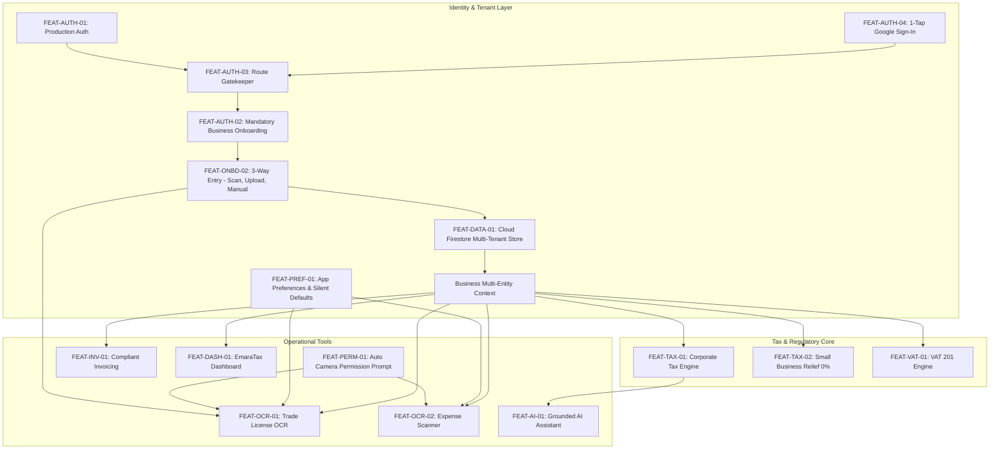

# Mizan (ميزان) - Feature Dependency Graph & Architecture Log

### Dependency Audit
- **Entry Security**: Users entering the mobile application must pass `AUTH` and verify identity.
- **Entity Pre-condition**: `DASH`, `TAX_ENG`, and `INVOICE` require `activeBusiness` with a valid `tradeLicenseNumber` and jurisdiction configuration.
- **Onboarding Gate**: If `businesses.length == 0`, the navigation stack intercepts routing and locks into `ONBOARD` until valid company details are committed.
